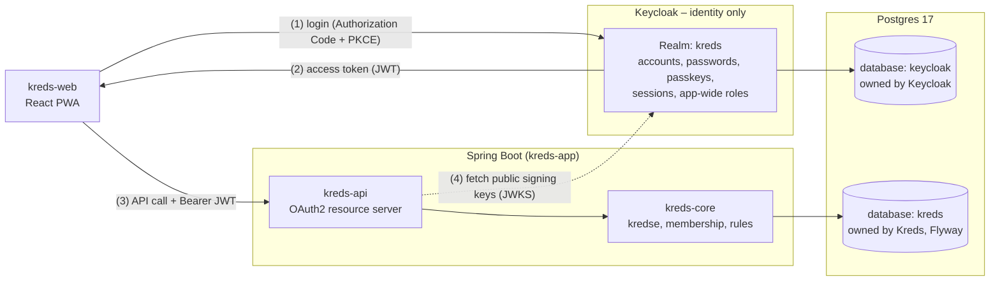
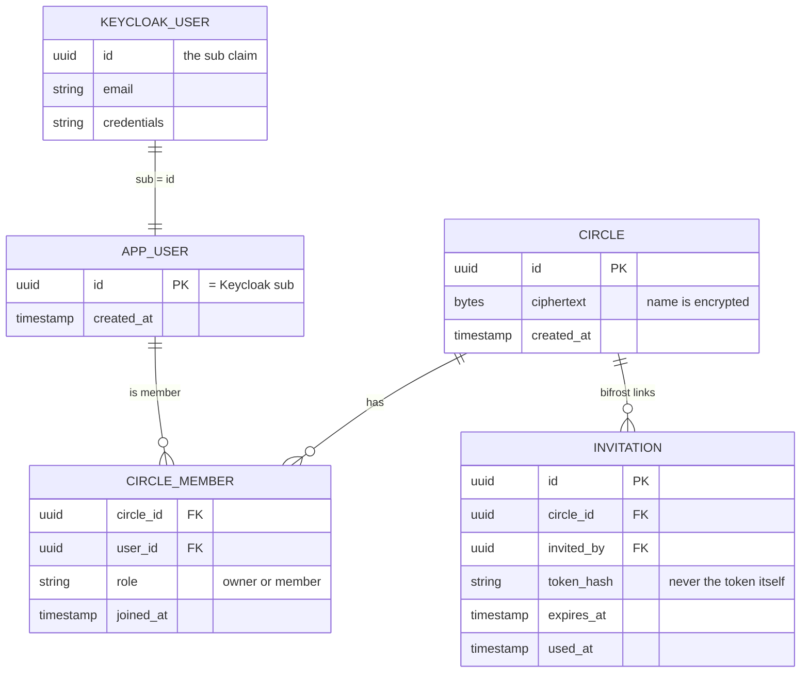
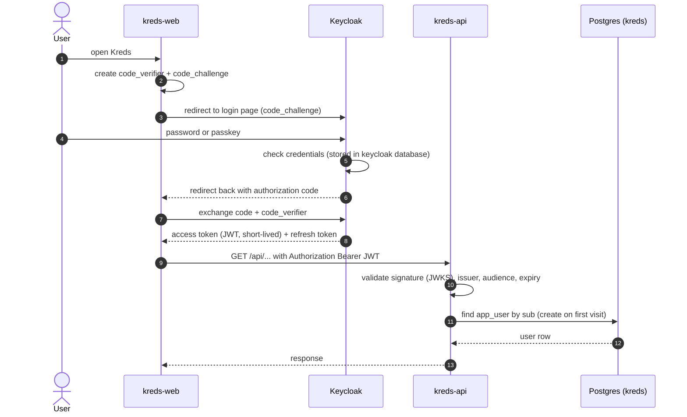
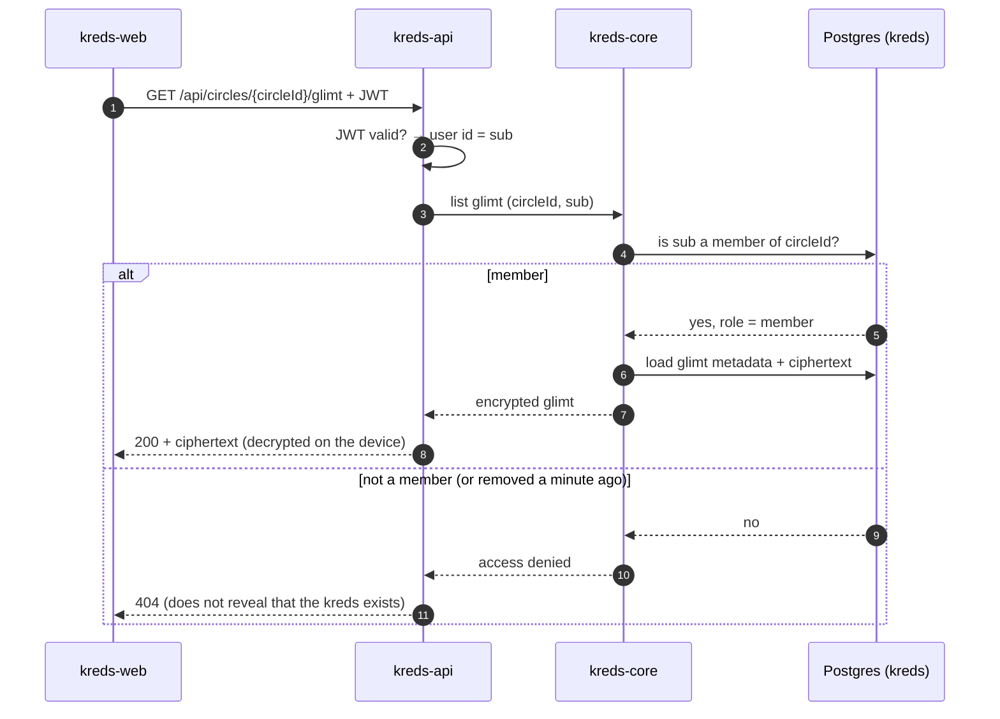
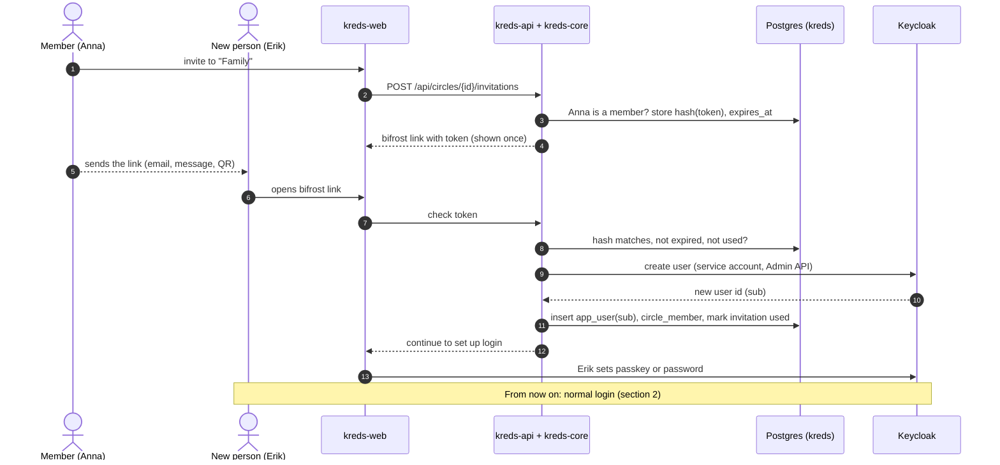

# Login and identity flow

How Kreds uses **Keycloak** for login and **Postgres** for everything the app itself knows about
users and their *kredse* – and how the two are connected.

> **Status:** design for Phase 2. The split (Keycloak = identity, Postgres = *kredse* and membership)
> is agreed and will be recorded as ADR-0002. Details marked **(proposal)** are not decided yet.

---

## 1. Who owns what

The one-sentence version: **Keycloak knows *who you are*. Postgres knows *which kredse you belong to*.
Neither knows *what you wrote*** – that is end-to-end encrypted (see [encryption-flow.md](encryption-flow.md)).

| | Keycloak | Postgres `kreds` database |
|---|---|---|
| **Holds** | Email, password hash, passkeys, sessions, login history, app-wide roles (e.g. operator admin) | Users (only the Keycloak ID), *kredse*, membership + role, invitations (*bifrost*), metadata, encrypted blobs |
| **Written by** | Keycloak only | `kreds-core` only, schema via Flyway |
| **Read by Spring Boot** | Never directly – only through the JWT | On every request |

### The link between the two: `sub`

Every Keycloak user has a stable, random ID – the `sub` claim in the JWT
(e.g. `3f2c9a1e-…`). Kreds uses it as the user ID in Postgres. **Nothing else is copied**:
no email, no password, no name from Keycloak lands in the `kreds` database.

`KEYCLOAK_USER` lives in the `keycloak` database and is shown only to explain the link – Kreds never
queries it. Table and column names are a **(proposal)** for the Flyway migrations in Phase 2.

---

## 2. Logging in (Authorization Code + PKCE)

The PWA is a public client: it cannot keep a secret. PKCE proves that the app which started the
login is the same app that picks up the token.

Spring Boot validates the JWT **locally** with Keycloak's public keys (fetched once and cached).
It does not call Keycloak on every request.

---

## 3. Every request: token for identity, Postgres for membership

**Why membership is not in the token:** a JWT is valid until it expires. If *kredse* were Keycloak
groups inside the token, a removed member could keep reading until then – and the token would carry
*kreds* names, which must stay encrypted. Reading membership from Postgres on every request makes
removal take effect immediately.

Returning `404` instead of `403` for a foreign *kreds* is a **(proposal)**.

---

## 4. Joining through a *bifrost* link (invite-only)

Kreds has no public sign-up. A new person can only get an account through a *bifrost* link from a
member. **(proposal)** – the exact mechanism is decided in ADR-0002. The flow below uses Keycloak's
Admin API with a dedicated, least-privilege service account.

Afterwards Erik's devices still have to join the *kreds*' MLS group (KeyPackage → Welcome), as in
[encryption-flow.md](encryption-flow.md). Login gives him an account, not the keys.

---

## 5. Postgres: one server, two databases

**(proposal)** Locally, Keycloak and Kreds share the existing Postgres 17 container, but each gets its
**own database and its own database user**:

| Database | User | Who creates the schema | Who may connect |
|---|---|---|---|
| `kreds` | `kreds` | Flyway (Spring Boot) | Spring Boot only |
| `keycloak` | `keycloak` | Keycloak itself, on start | Keycloak only |

Why separate:
- **Least privilege** – a bug in Kreds cannot read password hashes, and Keycloak cannot touch *kreds* data.
- Keycloak manages and migrates its own schema on upgrades; Flyway must never see it.
- Backups and restores can be done per database.
- Later they can move to two Postgres servers without changing any code.

---

## 6. Deleting an account

A user lives in two places, so deletion must cover both (`VISION.md` § 10):

1. `kreds-core` removes the user's rows in the `kreds` database (membership, own content, invitations).
2. `kreds-api` deletes the Keycloak user through the Admin API.
3. The audit log records *that* an account was deleted – never its content.

Order and retry on partial failure are **(proposal)** – details in Phase 2.

---

## 7. Rules

- Keycloak is **identity only**. No *kredse*, no membership, no content in Keycloak.
- The `sub` claim is the only link. Nothing else is copied from Keycloak to Postgres.
- Every request checks membership in Postgres, never from the token.
- Spring Boot never connects to the `keycloak` database.
- Keycloak is self-hosted (no US identity services). Its version is pinned, and Dependabot updates
  are merged promptly – only the latest release gets security fixes.
- Tokens, passwords and email addresses never appear in logs.

## Related

- ADR-0002 (planned) – Keycloak for identity only; *kreds* membership in Postgres
- [encryption-flow.md](encryption-flow.md) – what happens after login: MLS groups and encrypted messages
- [RFC 7636 – PKCE](https://www.rfc-editor.org/rfc/rfc7636)
