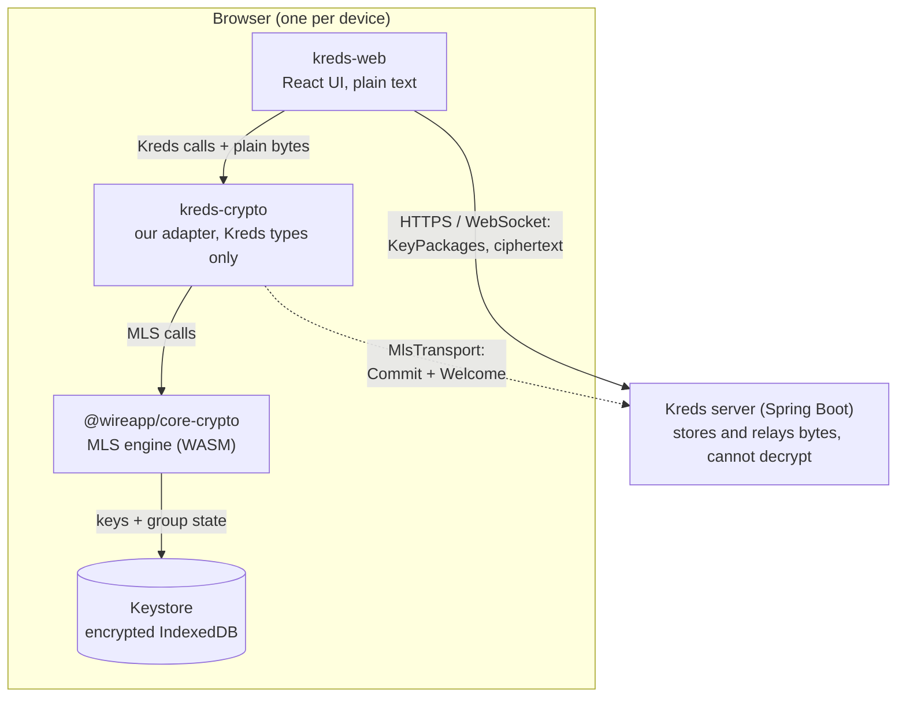
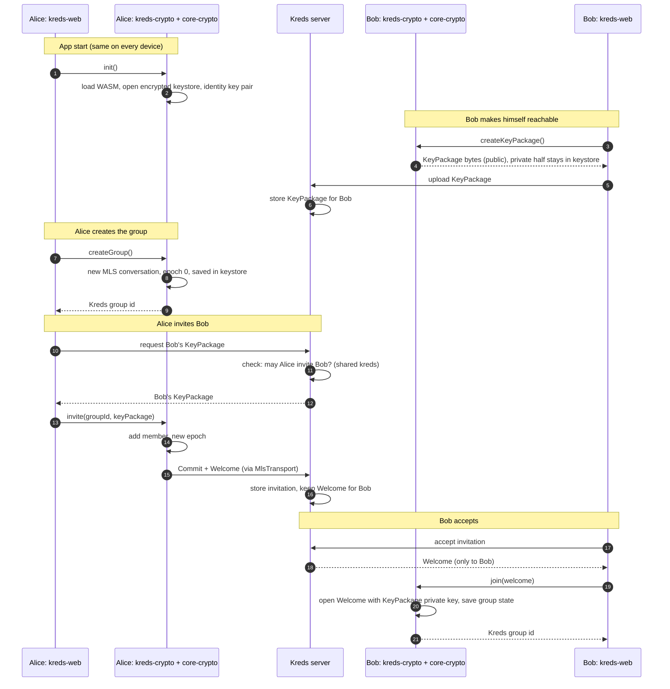
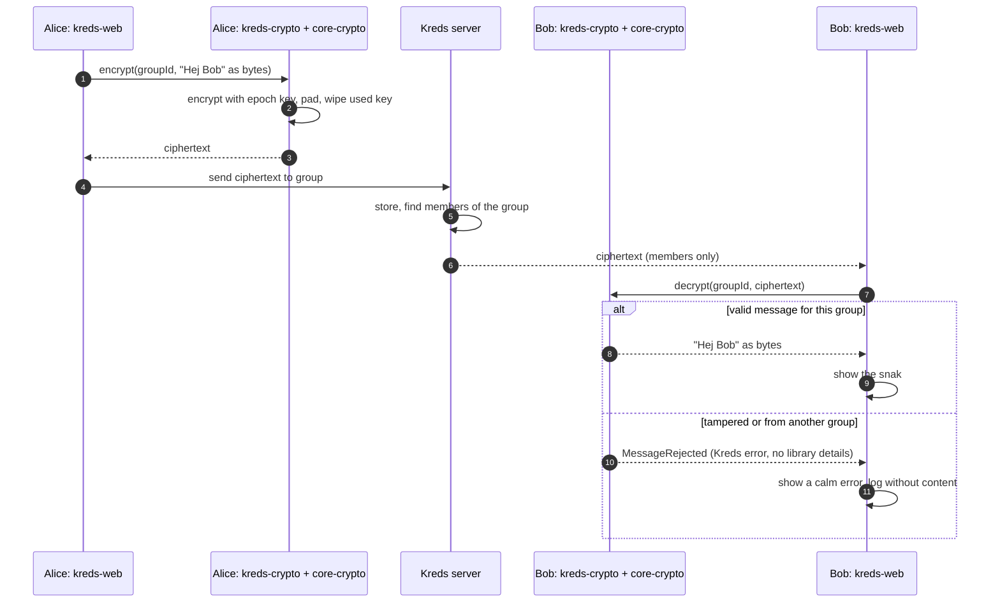

# Encryption flow

How Kreds encrypts a *snak* end to end with MLS (RFC 9420), using `@wireapp/core-crypto`
behind our own `kreds-crypto` adapter.

> **Status:** design. The `kreds-crypto` interface is not built yet. The method names below
> (`init`, `createKeyPackage`, `createGroup`, `invite`, `join`, `encrypt`, `decrypt`) are a
> proposal and may change during implementation.

---

## 1. The layers

| Layer | Knows about | Never does |
|---|---|---|
| `kreds-web` | Kreds words: snak, kreds, invitation | Import `@wireapp/core-crypto` |
| `kreds-crypto` | Kreds types **and** core-crypto | Let `ClientId`, `ConversationId` or other library types leave the package |
| `@wireapp/core-crypto` | MLS: keys, epochs, encryption, padding, key wiping | Talk to the network on its own (it hands outgoing messages to `MlsTransport`) |
| Keystore | Private keys and group state, encrypted | Leave the device |
| Server | Who is in which group, where to deliver bytes | See private keys or message content |

The adapter is what makes the library replaceable: `kreds-web` only depends on the `kreds-crypto`
interface, and one shared contract test suite runs against every adapter
(see ADR-0001).

---

## 2. Setup: Alice invites Bob into a snak

Why the server checks invitations: **anyone holding a user's KeyPackage can add that user to a
group** – MLS itself does not ask. Kreds therefore controls who may invite whom (only members
of a shared kreds) and adds an explicit "accept invitation" step.

---

## 3. Sending and reading a snak

---

## 4. What the server sees

| Step | Server sees | Server never sees |
|---|---|---|
| App start | Nothing | – |
| KeyPackage upload | Public KeyPackage of a device | Private keys |
| Create group | Nothing (local only) | – |
| Invite | Group id, epoch, sizes, who invited whom | Group secrets inside the Welcome |
| Join | Who received a Welcome | Group secrets |
| Snak | Group id, epoch, message size, sender, time | Message content |

This matches the data classification in `VISION.md`: metadata needed for delivery is visible,
content is always encrypted. Padding makes message sizes reveal less.

---

## 5. Rules

- Only `kreds-crypto` imports `@wireapp/core-crypto`. Library types never leave the package.
- Versions of `@wireapp/core-crypto` are pinned exactly and updated one major version at a time,
  in their own step.
- Errors from core-crypto are mapped to our own errors (e.g. `MessageRejected`). Logs never
  contain message content or keys.
- The server delivers messages and Welcomes only to members of the group.
- Never build our own crypto.

## Related

- ADR-0001 – `@wireapp/core-crypto` as the MLS library, behind a `kreds-crypto` adapter
- [RFC 9420 – The Messaging Layer Security (MLS) Protocol](https://www.rfc-editor.org/rfc/rfc9420)
